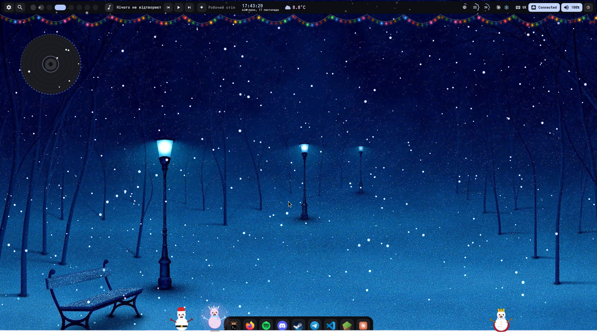

# ❄️ snowglobe

Turn your desktop into a snow globe. A New Year overlay for
[Quickshell](https://quickshell.org) on Hyprland (Wayland).



> ⚠️ **Work in progress.** There are a few bugs, but they will be fixed soon.
> The overlay is already usable.

## ✨ Features

- 🌨 Falling snow that piles up at the bottom of the screen and on windows
- 💡 Garlands, including a "music" mode that blinks to the beat
- 🎵 Dancing to music (reacts to your audio via cava)
- ⛄ Snowmen
- 🛷 Sleigh and 🚚 truck that you can call from the tray to clear the snow
- ⚪ Hold the right mouse button on the snow pile and drag: the snowball rolls and grows
- ⚙️ Settings menu and tray icon

## 📦 Install

Requirements: Hyprland, Quickshell, cava (for the music effects).

On Arch Linux:

```
sudo pacman -S cava
git clone https://github.com/z0350147-del/snowglobe ~/.config/quickshell/snowfall
qs -c snowfall -d
```

To restart after changes:

```
pkill -f 'qs -c snowfall'; qs -c snowfall -d
```

The wallpaper, bar and dock in the screenshot are not part of this project.

## 🐞 Known issues

- A few visual glitches may appear, they will be fixed in upcoming updates.
- Found a bug? Please open an issue and describe what happened.

## 🎄 Happy New Year!

---

## 🇺🇦 Українською

Перетвори робочий стіл на снігову кулю. Новорічний оверлей для Quickshell
на Hyprland: сніг, що лягає купами, гірлянди, які мигають у такт музиці,
сніговики, сани й вантажівка, які розчищають сніг. Затисни праву кнопку
миші на купі снігу й тягни, щоб скотити сніжку.

⚠️ Проєкт у розробці: є кілька багів, але їх скоро виправлять. Користуватись уже можна.
